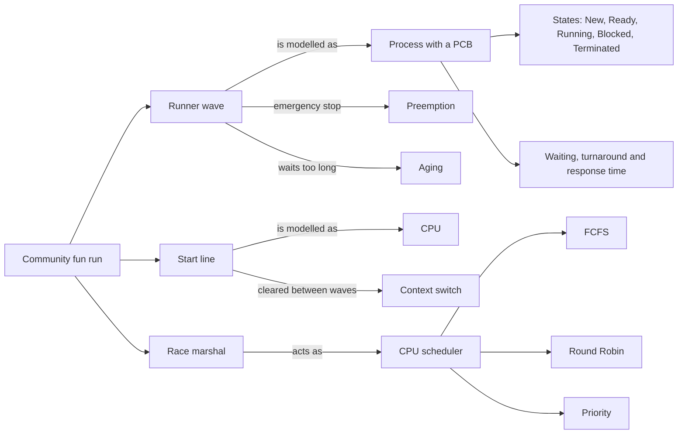

# Project Proposal: WaveFlow

**Wave Start Scheduler and Runner Tracker for a Community Fun Run**

Course: Operating System (BNF32303), POPBL assessment
Group 1, theme: Wave Starts & Runner Tracking
Core OS concepts: Process Scheduling and Process States

## Team members

| Name | Matric no. |
|---|---|
| Emir Sulaiman bin Khairul Faizi | AN260074 |
| Amir Wafiq bin Mohd Roslan | CN260417 |
| Muhammad Ammar bin Suandi Halil | CN260249 |
| Haris Sharafuddin bin Anuar | CN260379 |
| Mohammad Asyraf Khuzairie bin Hamzani | CN260297 |

## 1. Problem scenario

In a community fun run, runners cannot all leave the start line at the same time. If every category starts together, the first few hundred metres jam up, slower runners block faster ones, and marshals lose track of who is on the route. Organisers solve this by releasing runners in waves, such as the 21K, 10K, 5K, a family fun run and a wave for runners with disabilities (OKU).

The start line can only release one wave at a time, so the order and timing of the waves is a scheduling problem. This is the same problem an operating system faces when many processes want one CPU. Our group will build a program that treats each wave as a process and the start line as the CPU, and uses real scheduling algorithms to decide which wave goes next.

## 2. Objectives

1. Model runner waves as processes and the start line as the CPU.
2. Implement FCFS, Round Robin and Priority scheduling, written by the group without a scheduling library.
3. Track each wave through the process states New, Ready, Running, Blocked and Terminated.
4. Compare the three algorithms using average waiting time, turnaround time and response time.
5. Present the result on a simple dashboard that marshals and visitors can understand.

## 3. Scope

Inside the project: a simulation of wave scheduling for one race event, a dashboard with a Gantt chart, a wave state tracker, an algorithm comparison table, and unit tests for the scheduling logic.

Outside the project: real GPS or RFID tracking, a real registration database, and any work that belongs to the other groups (aid stations, registration, timing mats and the command centre).

## 4. Mapping the event to OS concepts

| Event | OS concept |
|---|---|
| Runner wave | Process |
| Wave record (name, runners, priority, arrival) | Process control block (PCB) |
| Start line | CPU |
| Race marshal who decides the next wave | CPU scheduler |
| Warm-up area | Ready queue |
| Slot of time a wave gets on the line | Time quantum |
| Clearing the line before the next wave | Context switch |
| Elite and OKU waves go first | Priority |
| Low priority wave waits too long | Starvation, solved by aging |
| Emergency stop on the start line | Interrupt and preemption |
| Wave waiting for the line to clear | Blocked state |

## 5. Proposed solution

WaveFlow is a Python application with a Streamlit dashboard. The user can edit the list of waves (arrival time, time needed on the start line, priority and number of runners), choose an algorithm, and run the simulation. The program then draws a Gantt chart of the start line, shows the state of every wave at any minute of the simulation, and compares the algorithms side by side.

### Scheduling algorithms

- FCFS: waves leave in the order they arrive. Simple, but a long wave can hold up many short ones.
- Round Robin: each wave gets a fixed time quantum, then goes to the back of the queue. This is fair, and it gives every wave an early start.
- Priority: the wave with the lowest priority number goes first. Elite and OKU waves can be placed first.

### Process states

| State | Meaning in the event |
|---|---|
| New | The wave has not reached the start area yet |
| Ready | The wave is in the warm-up area, waiting for the line |
| Running | The wave is releasing runners from the start line |
| Blocked | The wave is waiting while the line is cleared |
| Terminated | All runners in the wave have been released |

### Planned extra features

If time allows after the beta version: aging for priority scheduling, and an emergency interrupt button that stops the current wave and puts it back in the queue.

## 6. Technology

| Part | Tool |
|---|---|
| Language | Python |
| Dashboard | Streamlit |
| Charts | Plotly |
| Data | Pandas, with sample data in the program |
| Testing | Pytest |
| Version control | GitHub |
| Diagrams | Draw.io or Mermaid |
| Poster | Canva |

## 7. Initial concept map

## 8. Work plan

| Week | Activity | Deliverable |
|---|---|---|
| 4 | Finalise scenario and map it to OS concepts | This proposal and concept map in `/docs` |
| 5 | Design program logic, flowcharts and tool choices | System architecture diagram in `/docs` |
| 6 | Code the scheduling algorithms and PCB | Alpha code in `/src` |
| 7 | Debug and refine the prototype | Beta code in `/src` |
| 8 | Testing, UI integration and load testing | Final code in `/src`, technical report in `/docs` |
| 9 | Prepare poster, slides and a dry run | Materials in `/assets` |
| 10 | Live demonstration and pitch | Demo |
| 11 | Reflection and peer evaluation | Reflection report and updated README |

## 9. Team roles (proposed, to be confirmed by the group)

| Area | Member |
|---|---|
| Round Robin and PCB structure | (name) |
| Priority scheduling and aging | (name) |
| Runner state simulation | (name) |
| Dashboard and charts | (name) |
| Testing, documentation and poster | (name) |

Every member commits to the repository under their own account, and each member should be able to explain the whole program during the demo, not only their own part.

## 10. Testing approach

The scheduling logic will be checked with unit tests that compare the program output with schedules worked out by hand. We will also run the three algorithms on the same set of waves and compare their average waiting, turnaround and response times, then discuss which algorithm suits a fun run best and why.

## 11. Risks

| Risk | What we will do |
|---|---|
| A member is new to Git | Start with simple commits on the web, and pair up for the first week |
| Two people edit the same file | Give each member separate files or functions |
| Too little time for extra features | Finish the three algorithms and the dashboard first, add extras only after the beta |
| The demo fails on the day | Keep a recorded demo video in `/assets` as a backup |
